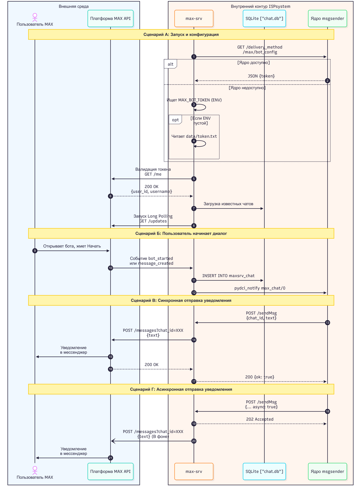

# Документация микросервиса max-srv

## Внимание: полчение/смена токена

При получении токена для MaxBot'а фактически создается новый UserName и ID для этого бота. 
Подробднее про использование см. раздел `4. API Контракт` пункт `GET /getBotInfo — Информация о боте`


## 1. Назначение сервиса

Микросервис **max-srv** предназначен для приёма синхронных и асинхронных запросов на отправку уведомлений в мессенджер **MAX** (`platform-api2.max.ru`), а также для автоматического обнаружения и сохранения пользователей, начавших диалог с ботом.

### Зачем потребовалось выносить отправку в отдельный микросервис?

- **Унификация и расширение системы:** Разработка отдельного сервиса продолжает модульный паттерн архитектуры платформы (по аналогии с `telegram-srv` и `slack-srv`). Это позволяет изолировать всю логику взаимодействия с внешним API мессенджера MAX в независимом компоненте.
- **Поддержка различных сценариев вызова:** Так как точный режим работы и требования вызывающей стороны (`msgsender`) к блокировкам могут различаться, `max-srv` спроектирован универсально. Сервис поддерживает как синхронную доставку, так и асинхронную (через флаг `async: true`).
- **Предотвращение потери сообщений при сбоях:** Микросервис берёт на себя сглаживание пиков отправки с помощью механизма ретраев с экспоненциальной задержкой, повышая шансы доставки при временной недоступности серверов MAX.
- **Отказоустойчивость:** Сетевые сбои или временная недоступность внешних серверов MAX изолируются внутри микросервиса и не влияют на стабильность работы вызывающего приложения (`msgsender`).
- **Автоматический сбор контактов:** В отличие от `telegram-srv` и `slack-srv`, `max-srv` самостоятельно обнаруживает новых пользователей через механизм Long Polling / Webhooks и сохраняет их `chat_id` в локальную базу данных SQLite.
- **Персистентное хранилище:** Список известных чатов хранится в файловой базе SQLite (`data/chat.db`), а не в оперативной памяти. При перезапуске контейнера данные сохраняются благодаря Docker Volume.

---

## 2. Архитектура и технологии

### Выбранные технологии

- **Python 3.10:** Базовый язык программирования, обеспечивающий высокую производительность разработки.
- **aiohttp (Web Server & HTTP Client):** Асинхронная библиотека для реализации как веб-сервера (приём входящих запросов от `msgsender`), так и HTTP-клиента (запросы к MAX API). Выбор обусловлен высокой производительностью `aiohttp` при работе с сетевыми сокетами и наличием встроенного пула соединений.
- **asyncio:** Библиотека для выполнения отправки сообщений и фоновых задач (Long Polling, обновление токена) без блокировки основного веб-сервера.
- **SQLite:** Лёгкая встраиваемая база данных для хранения списка известных чатов (`chat_id`, имя пользователя, дата первого обращения). Не требует внешних серверов и администрирования.

### Архитектурная связь с telegram-srv

В экосистеме уже существует микросервис `telegram-srv`, отвечающий за рассылку уведомлений в Telegram. При разработке `max-srv` мы применили концепцию **архитектурного наследования**, чтобы сохранить консистентность кодовой базы, но внесли критические улучшения:

**Что было сохранено:**
- **Технологический стек:** Сервис спроектирован на базе `aiohttp`.
- **Интерфейс:** Структура входящих данных и формат эндпоинтов (`POST /sendmsg` и `POST /sendMsg`) сделаны аналогичными `telegram-srv`.
- **Пул сетевых соединений:** Переиспользован паттерн глобальной сессии `ClientSession` для оптимизации расхода TCP-портов.

**Что было улучшено:**
- **Асинхронный неблокирующий режим:** так же как и в `slack-srv` реализована поддержка двух сценариев: при передаче флага `async: true` сервис мгновенно отвечает `202 Accepted`, а доставка выполняется в фоновом режиме через `asyncio.create_task`.
- **Механизм автоповторов (Exponential Backoff):** Встроен планировщик на `MAX_RETRIES` попыток с экспоненциально растущей задержкой (2^attempt секунд) при ошибках HTTP 429/5xx и сетевых сбоях.
- **Автообнаружение пользователей:** `max-srv` самостоятельно получает входящие события от MAX API (через Long Polling или Webhooks), парсит их и сохраняет `chat_id` новых пользователей в SQLite. `telegram-srv` этого не делает.
- **Двухуровневый механизм получения токена:** Фоновая задача `bot_config_refresher` сначала пытается получить токен от ядра `msgsender`. Если ядро недоступно — автоматически подхватывает локальный фоллбэк из файла `data/token.txt` или переменной окружения `MAX_BOT_TOKEN`.
### Внутреннее устройство сервиса

Архитектура `max-srv` состоит из четырёх ключевых уровней:

1. **Уровень сетевого интерфейса (HTTP API):** Принимает запросы по HTTP на эндпоинты `/sendMsg`, `/configureBot`, `/getBotInfo`, `/getKnownChannels`, `/webhook`. Выполняет валидацию структуры JSON-тела.

2. **Диспетчер режимов работы:** Анализирует параметр `async` во входящем запросе и распределяет нагрузку:
   - **Синхронный режим:** Работает по умолчанию (как в `telegram-srv`, для сохранения обратной совместимости). Блокирует обработчик, ожидая реального результата доставки от MAX API.
   - **Асинхронный режим:** Создаёт фоновую задачу через `asyncio.create_task` и мгновенно возвращает ответ `202 Accepted`, освобождая сетевой канал клиента.

3. **Асинхронный клиент доставки:** При старте приложения создаётся единая сессия `ClientSession`. Все фоновые задачи отправки используют эту сессию, переиспользуя TCP-порты для оптимизации трафика и исключения ошибок типа `TIME_WAIT`.

4. **Подсистема обнаружения пользователей (Event Processor):** Фоновая задача `bot_processor` получает входящие события от MAX API через Long Polling (или эндпоинт `/webhook` в продакшене). Единая функция `process_event_json()` обрабатывает события `bot_started` и `message_created`, извлекает `chat_id` и данные отправителя, и сохраняет новых пользователей в SQLite.

### Механизм обработки запросов к MAX API и отказоустойчивости

Доставка каждого сообщения контролируется конечным автоматом ретраев:

1. **Цикл попыток:** Сообщение отправляется повторно до `MAX_RETRIES` раз (по умолчанию 5).
2. **Экспоненциальная задержка (Exponential Backoff):** При ошибках HTTP 429 (rate limiting), HTTP 5xx (серверные сбои) или при сетевых ошибках задержка перед следующей попыткой вычисляется как `2^attempt` секунд (1с → 2с → 4с → 8с → 16с).
3. **Немедленное прерывание:** При получении клиентских ошибок типа HTTP 400 Bad Request ретраи немедленно останавливаются, и сервис возвращает статус сбоя.

---

## 3. Диаграмма взаимодействия

Ниже представлена диаграмма прохождения сообщений через систему в зависимости от выбранного режима отправки:



### Пояснения к сценариям

- **Сценарий А (Запуск):** При старте `max-srv` запрашивает токен у ядра `msgsender`. Если ядро недоступно, подхватывается локальный фоллбэк из переменной окружения `MAX_BOT_TOKEN` (основной рекомендуемый способ при запуске в Docker) или из файла `data/token.txt` (устаревший резервный вариант). Токен валидируется через `GET /me`. После этого загружаются чаты из SQLite и запускается Long Polling.
- **Сценарий Б (Opt-in):** Пользователь открывает бота в MAX и нажимает "Начать". MAX API доставляет событие в `max-srv`. Сервис сохраняет `chat_id` в SQLite и уведомляет ядро через `pydci_notify`.
- **Сценарий В (Синхронная отправка):** По аналогии со `slack-srv` — ядро `msgsender` отправляет `POST /sendMsg`, `max-srv` ждёт ответа от MAX API и возвращает результат. Вызывающая сторона блокируется до завершения доставки.
- **Сценарий Г (Асинхронная отправка):** По аналогии со `slack-srv` — при передаче `async: true` сервис мгновенно возвращает `202 Accepted`, а доставка выполняется в фоновой задаче через `asyncio.create_task`.
---

## 4. API Контракт

### Маршруты

| Метод | Маршрут | Описание |
|---|---|---|
| `POST` | `/sendMsg`, `/sendmsg` | Отправить сообщение в чат MAX |
| `POST` | `/configureBot` | Принудительно обновить токен бота |
| `GET` | `/getBotInfo` | Получить информацию о текущем боте |
| `GET` | `/getKnownChannels` | Список всех известных чатов из SQLite |
| `POST` | `/webhook` | Приём входящих событий от MAX API (Webhook-режим) |

### POST /sendMsg — Отправка сообщения

**Тело запроса (JSON):**

| Параметр | Тип | Обязательный | Описание |
|---|---|---|---|
| `chat_id` / `chat` | integer | да | ID чата пользователя в MAX |
| `text` / `msg` | string | да | Текст сообщения |
| `async` | boolean | нет (по умолчанию `false`) | Флаг переключения в асинхронный режим |

**Пример запроса:**

```json
{
  "chat_id": 54852788,
  "text": "Сервер vm42 перезагружен. Все сервисы запущены.",
  "async": true
}
```

**Коды ответов HTTP:**

| Код | Описание | Пример тела ответа |
|---|---|---|
| `200 OK` | Успешная доставка (синхронный режим) | `{"ok": true, "result": {...}}` |
| `202 Accepted` | Принято к доставке (асинхронный режим) | `{"ok": true, "status": "accepted"}` |
| `400 Bad Request` | Ошибка валидации или неустранимая ошибка MAX API | `{"ok": false, "error": "{\"code\":\"chat.not.found\",\"message\":\"Chat not found\"}"}` |

### POST /configureBot — Обновление токена

**Тело запроса:**

```json
{
  "token": "access_token_..."
}
```

**Ответ:** 
- `200 OK` при успешной валидации.
- `400 Bad Request` при невалидном токене. Пример ответа:
```json
{
  "ok": false,
  "error": "Invalid token",
  "details": "{\"code\":\"verify.token\",\"message\":\"Invalid access_token\"}"
}
```

### GET /getBotInfo — Информация о боте

**Ответ:**

```json
{
  "ok": true,
  "bot_info": {
    "user_id": 340468145,
    "first_name": "Уведомления ISPsystem",
    "username": "id9731012897_bot",
    "is_bot": true,
    "last_activity_time": 1786461769097,
    "description": "Доставка уведомлений от программных продуктов компании ISPsystem ",
    "avatar_url": "https://i.oneme.ru/i?r=BTFjO43w8Yr1OSJ4tcurq5Hi3GEAp-sWcs1gkZ0IATJnfYGrGWgYcOhm0pDvUnwgvuE",
    "full_avatar_url": "https://i.oneme.ru/i?r=BTFjO43w8Yr1OSJ4tcurq5Hi5_yP3dC7h_STYtCnKdRSBIGrGWgYcOhm0pDvUnwgvuE",
    "name": "Уведомления ISPsystem"
  },
  "has_token": true
}
```

### GET /getKnownChannels — Список известных чатов

**Ответ:**

```json
[
  {
    "chat_id": 433571016,
    "username": "",
    "first_name": "Артём",
    "last_name": "Шишкин",
    "created_at": "2026-08-11 08:35:21"
  }
]
```

---

## 5. Получение входящих событий: Long Polling vs Webhooks

### Текущий режим: Long Polling

На этапе тестирования сервис работает в режиме **Long Polling**: фоновая задача `bot_processor` в цикле делает запрос `GET /updates?timeout=30` к MAX API и ожидает входящие события до 30 секунд.

**Причина:** На тестовом стенде нет публичного (белого) IP-адреса, поэтому серверы MAX не могут инициировать входящее подключение.

### Подготовка к Webhooks (продакшен)

Архитектура `max-srv` спроектирована с заделом на переход к Webhooks:
- Эндпоинт `POST /webhook` уже реализован и зарегистрирован.
- И Long Polling, и Webhook используют **единую функцию** `process_event_json()` — переключение не требует изменения бизнес-логики.

**Для перехода на Webhooks необходимо:**
1. Обеспечить публичный IP + домен + HTTPS (Nginx / Reverse Proxy с SSL Termination).
2. Зарегистрировать URL вебхука в MAX API (запрос `POST /subscriptions`).
3. Отключить фоновую задачу Long Polling (`bot_processor`) в `on_startup`.
4. Добавить проверку подлинности входящих запросов (Secret Header / IP Whitelisting).

---

## 6. Нюансы реализации

### 6.1. SSL-сертификаты Минцифры

Платформа `platform-api2.max.ru` использует SSL-сертификаты, выданные Национальным Удостоверяющим Центром Минцифры РФ. В стандартных Docker-образах на базе Debian/Ubuntu эти сертификаты отсутствуют, что приводит к ошибке `SSL certificate problem: unable to get local issuer certificate`.

**Решение:** В `Dockerfile` добавлен этап, который при сборке скачивает корневой и промежуточный сертификаты Минцифры с официального портала Госуслуг (`gu-st.ru`) и регистрирует их через `update-ca-certificates`.

### 6.2. Формат запросов к MAX API

MAX API отличается от Telegram Bot API форматом отправки сообщений. Через тестирование выяснено, что `chat_id` передаётся как **query-параметр в URL**, а не в теле JSON:

```
POST https://platform-api2.max.ru/messages?chat_id=54852788
Authorization: <token>
Content-Type: application/json

{"text": "Текст сообщения"}
```

### 6.3. Модуль pydci_notify

`pydci_notify` — внутренняя библиотека ISPsystem для уведомления ядра `msgsender` о появлении новых чатов. На тестовом стенде внутренний PyPI недоступен, поэтому модуль работает в режиме заглушки (Graceful Degradation). При деплое в продакшен необходимо раскомментировать зависимость в `requirements.txt` и настроить доступ к внутреннему PyPI.

### 6.4. Ограничения и лимиты MAX API

1. **Ограничение скорости (Rate Limit):** Максимальное количество запросов составляет всего **2 RPS** (запроса в секунду).
2. **Таймаут запроса:** 30 секунд.
3. **Размер батча (пачки обновлений):** Не более 100 событий за один запрос.
4. **Срок жизни событий (TTL):** Недоставленные события хранятся только **24 часа**, после чего удаляются.

---

## 7. Конфигурация

Микросервис настраивается с помощью следующих переменных окружения:

| Переменная | Значение по умолчанию | Описание |
|---|---|---|
| `MAX_RETRIES` | `5` | Максимальное число повторных попыток отправки при сбоях |
| `PORT` | `8080` | Внутренний порт веб-сервера |
| `DB_PATH` | `data/chat.db` | Путь к файлу SQLite базы данных |
| `PRODUCT` | `vm` | Название продукта ISPsystem |
| `PROXY_SERVICE` | `vm_box` | Имя контейнера ядра для формирования URL msgsender |
| `MSG_SENDER_URL` | `http://vm_box/msgsender/v3` | Полный URL ядра msgsender |
| `MAX_BOT_TOKEN` | *(не задан)* | Локальный фоллбэк токена бота (альтернатива файлу `data/token.txt`) |

---

## 8. Деплой и развёртывание

Служба запускается в виде Docker-контейнера.

### Dockerfile

Сервис упаковывается на базе легковесного Python-образа с установкой сертификатов Минцифры:

```dockerfile
FROM python:3.10-slim

RUN apt-get update \
    && apt-get install -y --no-install-recommends curl ca-certificates \
    && curl -sSf -o /usr/local/share/ca-certificates/russian_trusted_root_ca.crt \
       https://gu-st.ru/content/lending/russian_trusted_root_ca_pem.crt \
    && curl -sSf -o /usr/local/share/ca-certificates/russian_trusted_sub_ca.crt \
       https://gu-st.ru/content/lending/russian_trusted_sub_ca_pem.crt \
    && update-ca-certificates \
    && apt-get purge -y curl \
    && apt-get autoremove -y \
    && rm -rf /var/lib/apt/lists/*

WORKDIR /app
COPY requirements.txt .
RUN pip install --no-cache-dir -r requirements.txt
RUN mkdir -p /var/log /app/data
COPY scripts/ /app/scripts/

ENV MAX_RETRIES=5
ENV PORT=8080

CMD ["python", "scripts/maxsrv.py"]
```

### Запуск через Docker Compose

Сервер подключается к общей Docker-сети проекта (`vm_vm_box_net`) для связи с `msgsender`:

```yaml
services:
  max-srv:
    build: .
    container_name: max-srv
    restart: always
    ports:
      - "8083:8080"
    environment:
      - MAX_RETRIES=5
    networks:
      - vm_vm_box_net
    volumes:
      - ./logs:/var/log
      - ./data:/app/data

networks:
  vm_vm_box_net:
    external: true
```

**Примечание к volumes:**
- `./logs:/var/log` — логи сервиса сохраняются на хосте для анализа.
- `./data:/app/data` — база SQLite (`chat.db`) и файл фоллбэк-токена (`token.txt`) персистятся между перезапусками контейнера.

---


