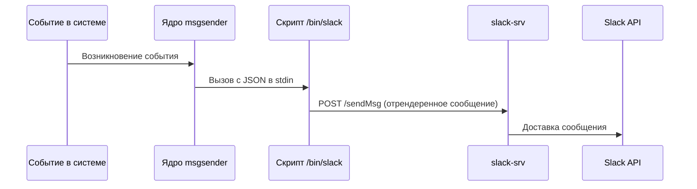

# Интеграция со Slack и Mattermost: Основной контур (msgsender)

Этот документ описывает работу основного контура отправки уведомлений в Slack на стороне компонента `msgsender`. Документация предназначена для разработчиков, которые будут сопровождать, развертывать или развивать данную интеграцию.

> **Совместимость с Mattermost:** Данная интеграция полностью совместима с Mattermost, так как использует стандартный формат Incoming Webhooks. Везде в тексте, где упоминается Slack, описанный механизм в равной степени применим и к Mattermost.

> **Архитектурное решение (Webhooks vs Apps):** Текущее техническое задание не требовало обеспечения двустороннего общения с пользователем (интерактива, команд бота). Поэтому было принято решение использовать механизмы Incoming Webhooks вместо полноценных Slack/Mattermost Apps, так как вебхуки значительно проще в интеграции и поддержке.
> 
> * **Получение Webhook в Slack:** Перейдите в настройки вашего Workspace -> "Apps" -> "Custom Integrations" -> "Incoming WebHooks" (или создайте новое Slack App и активируйте в нем Incoming Webhooks). Сгенерируйте URL для целевого канала.
> * **Получение Webhook в Mattermost:** В главном меню выберите "Integrations" -> "Incoming Webhooks" -> "Add Incoming Webhook" и укажите канал, куда будут приходить уведомления. После сохранения вы получите заветный URL.

## Общий контур системы

Отправка уведомлений в Slack представляет собой следующую цепочку действий:

1. **Генерация события**: В системе возникает событие (алерт, системное сообщение), которое требует отправки.
2. **Ядро `msgsender`**: Бинарник `msgsender` обрабатывает это событие.
   > **Важное уточнение:** Внутренняя логика самого бинарника `msgsender` и алгоритм принятия решений (когда и кому отправлять уведомление) в рамках данной реализации рассматривается нами как **«черный ящик»**. Наша интеграция со Slack была построена по аналогии с уже существующей интеграцией для Telegram. Мы предполагаем, что `msgsender` корректно определяет факт необходимости отправки в Slack и вызывает наш скрипт.
3. **Вызов скрипта**: Ядро вызывает скрипт отправки уведомления `/bin/slack`.
4. **Маршрутизация**: Скрипт формирует сообщение под нужный шаблон, подставляет требуемые параметры и применяет нужную локаль (язык), после чего подготавливает полезную нагрузку и отправляет её в отдельный микросервис `slack-srv`.
5. **Отправка в Slack API**: Микросервис `slack-srv` непосредственно связывается с API Slack и доставляет сообщение в нужный канал или пользователю.

---

## Шаблоны (Templates)

Тексты уведомлений генерируются динамически на основе шаблонов.

* **Структура:** Все шаблоны располагаются в директории: `/opt/ispsystem/msgsender/etc/template`.
* **Локализация (i18n):** Шаблонизация работает на базе **Jinja2** с подключенным расширением `jinja2.ext.i18n` и стандартной библиотекой `gettext`. 
* **Переводы:** Файлы переводов хранятся в поддиректории `locale`. Выбор конкретного каталога с переводами зависит от параметра `language`, который передается внутри поля `msg` из стандартного ввода.

---

## Скрипт `/bin/slack`

Скрипт `/bin/slack` (`msgsender/bin/slack`) выступает связующим звеном между ядром системы (после применения шаблонов) и микросервисом `slack-srv`. 

* **Формат входных данных:** Скрипт получает данные от бинарника `msgsender` через стандартный поток ввода (`stdin`) в формате JSON. Ожидается, что JSON содержит:
  * `webhook_url` — URL вебхука или эндпоинт, куда нужно доставить сообщение.
  * `msg` — параметры сообщения (например, язык `language` и подстановочные переменные).
  * `template` — данные шаблона, по которому будет сформировано тело уведомления.
* **Логика обработки:** 
  1. Скрипт парсит JSON из `stdin`.
  2. Выполняет рендеринг сообщения с использованием шаблонизатора **Jinja2**. При этом учитывается интернационализация (локализация) текста.
  3. Формирует POST-запрос с подготовленным текстом и адресом получателя.
  4. Отправляет этот запрос в микросервис `slack-srv` по HTTP на эндпоинт `/sendMsg`.

---

## Скрипты синхронизации (Sync scripts)

В `msgsender` изначально присутствуют скрипты синхронизации каналов и пользователей:
* `msgsender/bin/channel_syncer.py`
* `msgsender/bin/user_syncer.py`

**Статус реализации:** Мы добавили в эти существующие скрипты функции по аналогии с интеграцией для Telegram, чтобы в будущем обеспечить возможности маппинга пользователей и каналов Slack. Однако на текущем этапе этот функционал **не был протестирован**. При необходимости его использования потребуется дополнительная верификация и отладка.

---

## Развертывание, конфигурация и Диагностика проблем (Troubleshooting)

Этот раздел описывает нюансы работы контура, специфичные именно для интеграции со Slack.

### Зависимости и Развертывание (Деплой)
Для успешной отправки сообщений скрипт `/bin/slack` **обязательно требует** наличия запущенного контейнера микросервиса `slack-srv` в той же сети (или доступного по сети). Без него скрипт вернет ошибку.

**Запуск микросервиса `slack-srv`:**
Микросервис `slack-srv` поднимается из другого репозитория. Убедитесь, что вы запустили соответствующий контейнер в вашем окружении (например, через свой `docker-compose.yml`), чтобы интеграция со стороны `msgsender` могла успешно к нему обращаться. Подробная информация по настройке и запуску микросервиса находится в репозитории: [slack-srv](http://192.168.18.6:3000/asutenshi/slack-srv).

### Переменные окружения
Так как контейнер `msgsender` часто формируется на основе уже запущенной системы (например, `vmmanager`), некоторые переменные окружения могут отличаться в зависимости от конкретного продукта и развертывания. 

Основные переменные для интеграции со Slack:
* `SLACK_SRV_HOST` (по умолчанию `slack-srv:8080`) — адрес и порт, по которому скрипт `/bin/slack` будет искать запущенный микросервис `slack-srv`. Если имя контейнера микросервиса или его порт в вашей среде настроены иначе, эту переменную необходимо переопределить.

### Диагностика проблем
Если уведомления не доставляются в Slack, проверьте стык между основным контуром и микросервисом:

1. **Где искать логи:** Логи выполнения скрипта `/bin/slack` пишутся в файл `/var/log/slack.log` внутри контейнера `msgsender`.
2. **Частые проблемы:**
   * **Ошибки `500` или коды `202` от `slack-srv`:** Ищите в логах строку `slack-srv error: ...`. Это означает, что скрипт успешно отработал и передал данные, но микросервис вернул ошибку, либо сообщил, что задача взята в асинхронную обработку (`202`), но доставка не удалась. В этом случае нужно проверять логи самого `slack-srv` (`/var/log/slack-srv.log`).
   * **Ошибки соединения (Connection Refused):** Означает, что переменная `SLACK_SRV_HOST` указывает на неверный адрес, либо контейнер `slack-srv` не запущен или упал.

---

## Разработка и тестирование

### Детали реализации (Implementation Notes)
Для получения информации о том, какие конкретно изменения были внесены в систему для добавления интеграции со Slack по аналогии с Telegram (изменение `metadata`, `sync`-скриптов и т.д.), обратитесь к файлу: [IMPLEMENTATION_NOTES.md](./IMPLEMENTATION_NOTES.md).

### Тестовый скрипт
Для локальной отладки и проверки работоспособности отправки (чтобы исключить долгое ручное тестирование) разработан специальный тестовый скрипт. С его помощью можно протестировать формирование и отправку сообщений, не поднимая весь ядровой контур `msgsender`.
**Документация по тестированию и запуску скрипта:** [README_tests.md](./README_tests.md)
