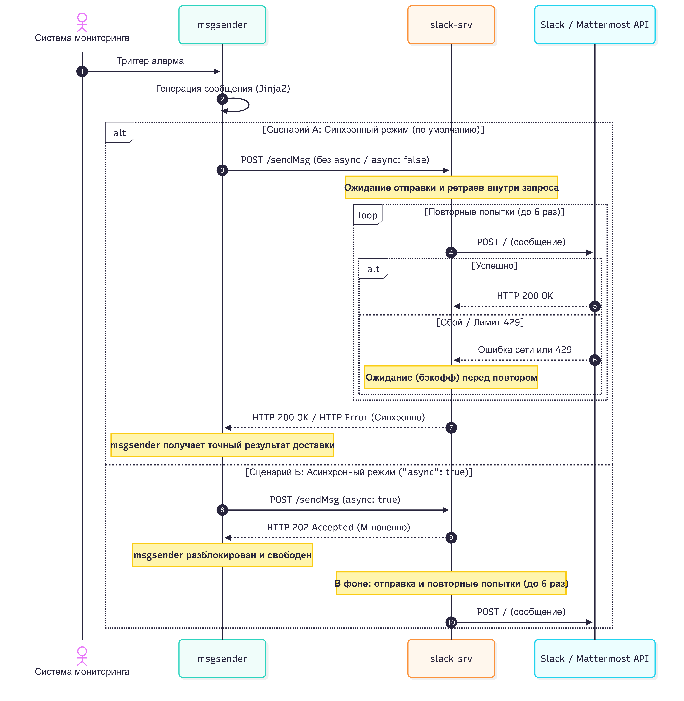

## 1. Назначение сервиса

Микросервис `slack-srv` предназначен для приема синхронных и асинхронных запросов на отправку уведомлений во внешние API мессенджеров (Slack/Mattermost).

### Зачем потребовалось выносить отправку в отдельный микросервис?
1. **Унификация и расширение системы**: Разработка отдельного сервиса продолжает модульный паттерн архитектуры платформы (по аналогии с `telegram-srv`). Это позволяет изолировать всю логику взаимодействия с внешними API мессенджеров в независимых компонентах.
2. **Поддержка различных сценариев вызова**: Так как точный режим работы и требования вызывающей стороны (`msgsender`) к блокировкам могут различаться, `slack-srv` спроектирован универсально. Сервис поддерживает как синхронную доставку, так и асинхронную.
3. **Предотвращение потери сообщений при лимитах**: Slack накладывает жесткие ограничения на частоту запросов через Incoming Webhooks (не более 1 сообщений в секунду). Микросервис берет на себя сглаживание пиков отправки с помощью механизма ретраев, гарантируя доставку.
4. **Отказоустойчивость**: Сетевые сбои или временная недоступность внешних серверов Slack/Mattermost изолируются внутри микросервиса и не влияют на стабильность работы вызывающего приложения.
5. **In-memory очередь**: Очередь повторных попыток хранится исключительно в оперативной памяти (RAM). 
    - **Минус:** при жестком падении или перезапуске контейнера `slack-srv` недоставленные сообщения будут потеряны.
    -   **Почему так сделано**: решение принято для сохранения легковесности сервиса по аналогии с `telegram-srv`, который также не использует внешние базы данных.

---

## 2. Архитектура и технологии
### Выбранные технологии
* **Python 3.x**: Базовый язык программирования, обеспечивающий высокую производительность.
* **`aiohttp` (Web Server & HTTP Client)**: Асинхронная библиотека для реализации как веб-сервера, так и веб-клиента. Выбор обусловлен высокой производительностью `aiohttp` при работе с сетевыми сокетами и наличием встроенного пула соединений.
* **`asyncio`**: Библиотека для выполнения отправки сообщений в фоновом режиме без блокировки основного веб-сервера.

---

### Архитектурная связь с `telegram-srv`
В экосистеме уже существует микросервис **`telegram-srv`**, отвечающий за рассылку уведомлений в Telegram. При разработке `slack-srv` мы применили концепцию **архитектурного наследования**, чтобы сохранить консистентность кодовой базы, но внесли критические улучшения:

* **Что было сохранено**:
  * **Технологический стек**: Сервис спроектирован на базе `aiohttp`.
  * **Интерфейс**: Структура входящих данных и формат эндпоинтов (`POST /sendmsg` и `POST /sendMsg`) сделаны аналогичными `telegram-srv`.
  * **Пул сетевых соединений**: Переиспользован паттерн глобальной сессии `ClientSession` для оптимизации расхода TCP-портов.

* **Что было улучшено**:
  * **Асинхронный неблокирующий режим**: В `slack-srv` реализована поддержка двух сценариев: при передаче флага `async: true` сервис мгновенно отвечает `202 Accepted`, а доставка выполняется в фоновом режиме через `asyncio.create_task`.
  * **Механизм автоповторов**: В `slack-srv` встроен планировщик на `MAX_RETRIES` попыток.
  * **Интеллектуальная обработка лимитов**: `slack-srv` умеет считывать заголовки `Retry-After` от внешних серверов при ошибках `HTTP 429` и приостанавливать отправку на строго указанное время, либо использовать экспоненциальный бэкофф при сетевых сбоях и работе с Mattermost.

---

### Внутреннее устройство сервиса
Архитектура `slack-srv` состоит из трех ключевых уровней:

1. **Уровень сетевого интерфейса**:
   Принимает запросы по HTTP POST на эндпоинты `/sendmsg` и `/sendMsg`. Выполняет валидацию структуры JSON-тела.
2. **Диспетчер режимов работы**:
   Анализирует параметр `"async"` во входящем запросе и распределяет нагрузку:
   * **Синхронный режим**:
      * работает по умолчанию, так как в `telegram-srv` не реализована асинхронная отправка, и мы сохраняем обратную совместимость;
      * блокирует выполнение обработчика, ожидая реального результата доставки от внешнего сервера.
   * **Асинхронный режим**:
      * создает фоновую задачу планировщика и мгновенно возвращает ответ `202 Accepted`, освобождая сетевой канал клиента.
3. **Асинхронный клиент доставки**:
   При старте приложения создается единая сессия `ClientSession`. Все фоновые задачи отправки используют эту сессию, переиспользуя TCP-порты для оптимизации трафика и исключения ошибок типа `TIME_WAIT` (исчерпание портов).

---

### Механизм обработки запросов к Slack и отказоустойчивости
Доставка каждого сообщения контролируется конечным автоматом ретраев:

* **Цикл попыток**: Сообщение отправляется повторно до `MAX_RETRIES` раз (по умолчанию 5).
* **Интеллектуальная задержка**:
  * При ошибке **HTTP 429** сервис проверяет наличие заголовка `Retry-After`. Если он передан, сервис приостанавливает выполнение задачи ровно на указанное внешней системой количество секунд.
  * Если же заголовок отсутствует, или при ошибках сети, сбоях серверов (HTTP 5xx), применяется алгоритм **экспоненциального ожидания** — задержка перед следующей попыткой вычисляется как $2^{\text{попытка}}$ секунд.
* **Немедленное прерывание**: При получении клиентских ошибок типа `HTTP 400 Bad Request` или `HTTP 404 Not Found` ретраи немедленно останавливаются, и сервис возвращает статус сбоя.

---

## 3. Диаграмма взаимодействия

Ниже представлена диаграмма прохождения сообщений через сервис в зависимости от выбранного режима отправки:



### Пояснения к сценариям
* **Сценарий А (Синхронный)**: `msgsender` не передает `"async"` (или передает `false`). `slack-srv` выполняет отправку с ретраями в основном потоке HTTP-запроса. `msgsender` ждет и получает точный результат.
* **Сценарий Б (Асинхронный)**: `msgsender` передает параметр `"async": true`. Микросервис принимает задачу, ставит ее в фоновую очередь и моментально возвращает код `202 Accepted`. `msgsender` мгновенно разблокируется, а доставка происходит независимо.

---

## 4. API Контракт

### Маршруты
* `POST /sendmsg`
* `POST /sendMsg`

### Тело запроса (JSON)
* `webhook` (string, обязательное) — URL вебхука Slack или Mattermost.
* `text` (string, обязательное) — Текст сообщения.
* `async` (boolean, опциональное, по умолчанию `false`) — Флаг переключения в асинхронный режим.

#### Пример запроса
```json
{
  "webhook": "http://192.168.18.16:8065/hooks/7e4kf6wru7yzpk6x5to3tzzptr",
  "text": "Тестовое оповещение от системы мониторинга",
  "async": true
}
```

### Коды ответов HTTP
* **`200 OK`**: Успешная доставка сообщения в синхронном режиме.
  ```json
  {"ok": true}
  ```
* **`202 Accepted`**: Сообщение принято к доставке в асинхронном режиме.
  ```json
  {"ok": true, "msg": "Message accepted for delivery"}
  ```
* **`400 Bad Request`**: Ошибка в запросе.
  ```json
  {"ok": false, "error": "Missing webhook or text field"}
  ```
* **`429 Too Many Requests`** / **`500 Internal Server Error`**: Ошибка доставки в синхронном режиме (после исчерпания всех попыток).
  ```json
  {"ok": false, "error": "Rate limited (429)"}
  ```

---

## 5. Конфигурация

Микросервис настраивается с помощью следующих переменных окружения:

| Переменная | Значение по умолчанию | Описание |
| :--- | :--- | :--- |
| `MAX_RETRIES` | `5` | Максимальное число повторных попыток отправки при сбоях. |
| `PORT` | `8080` | Внутренний порт, на котором запускается веб-сервер. |

---

## 6. Деплой и развертывание

Служба запускается в виде Docker-контейнера.

### 1. Dockerfile
Сервис упаковывается на базе легковесного Python-образа:
```dockerfile
FROM python:3.12-slim
WORKDIR /app
COPY requirements.txt .
RUN pip install --no-cache-dir -r requirements.txt
COPY . .
CMD ["python", "scripts/slacksrv.py"]
```

### 2. Запуск через Docker Compose
Сервер подключается к общей Docker-сети проекта (`vm_vm_box_net`) для связи с `msgsender`:
```yaml
services:
  slack-srv:
    build: .
    container_name: slack-srv
    restart: always
    ports:
      - "8080:8080"
    environment:
      - MAX_RETRIES=5
    networks:
      - vm_vm_box_net
    volumes:
      - ./logs:/var/log

networks:
  vm_vm_box_net:
    external: true
```

---

## 7. Связанные репозитории и документация

* **[msgsender-slack](http://192.168.18.6:3000/asutenshi/msgsender-slack)** — основной контур отправки уведомлений.
* **[README_tests.md](http://192.168.18.6:3000/asutenshi/msgsender-slack/src/branch/main/README_tests.md)** — документация по тестированию контура.
